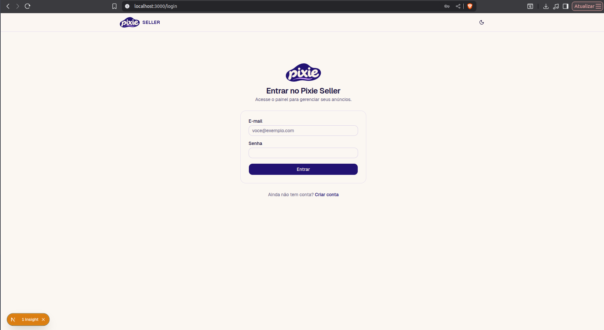
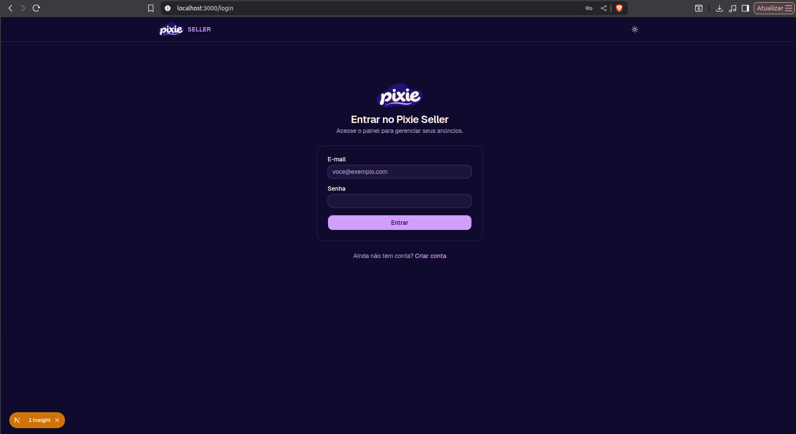
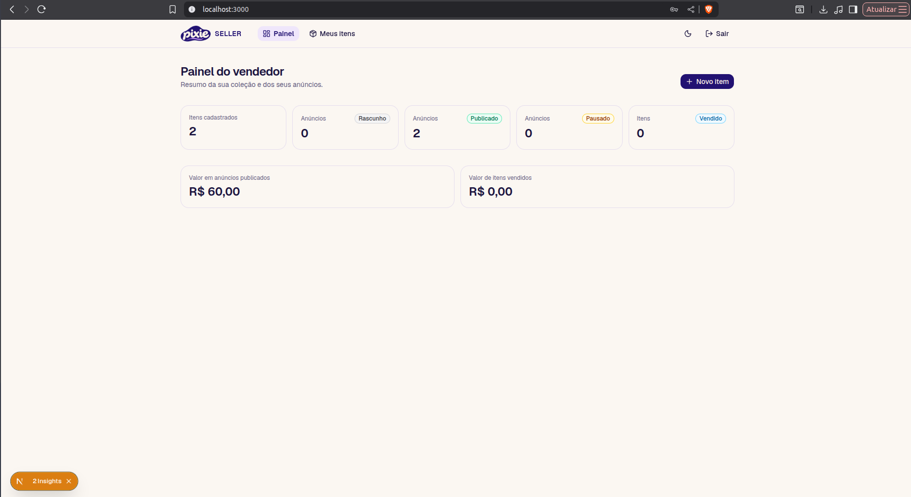
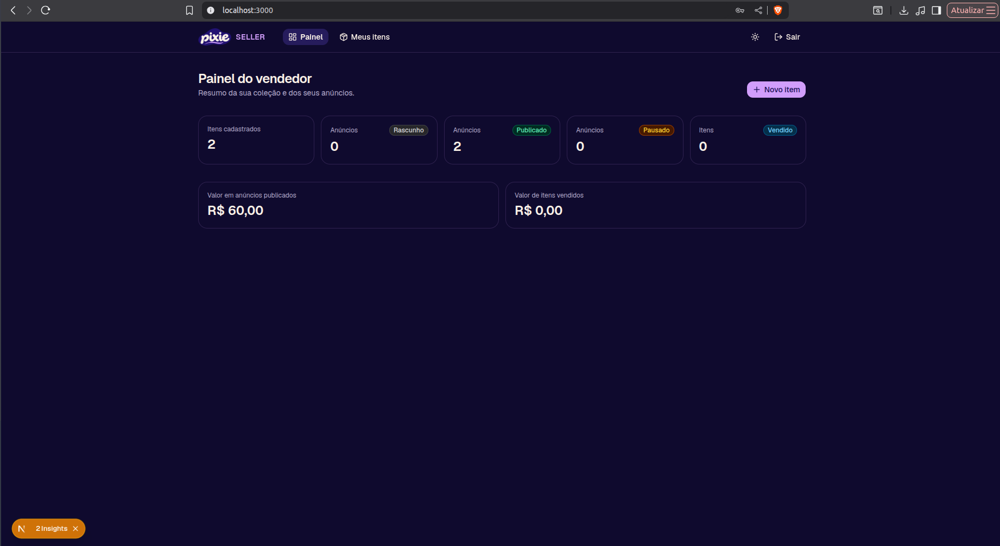
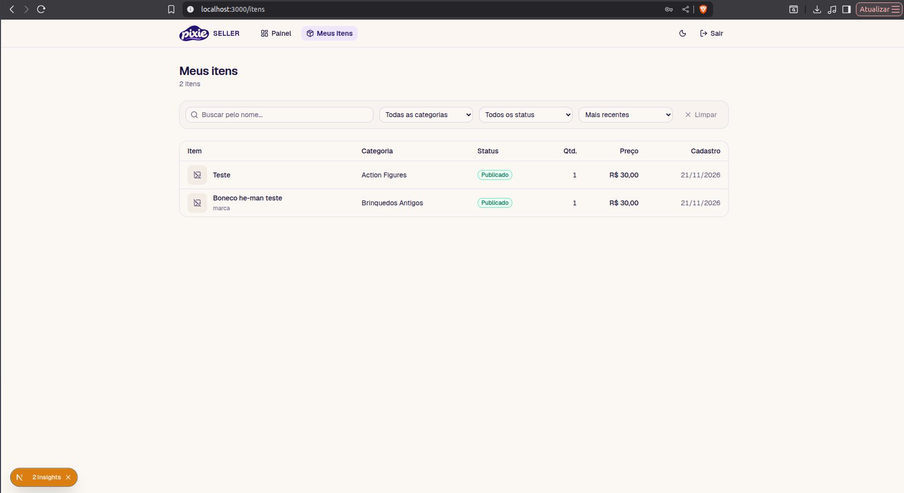
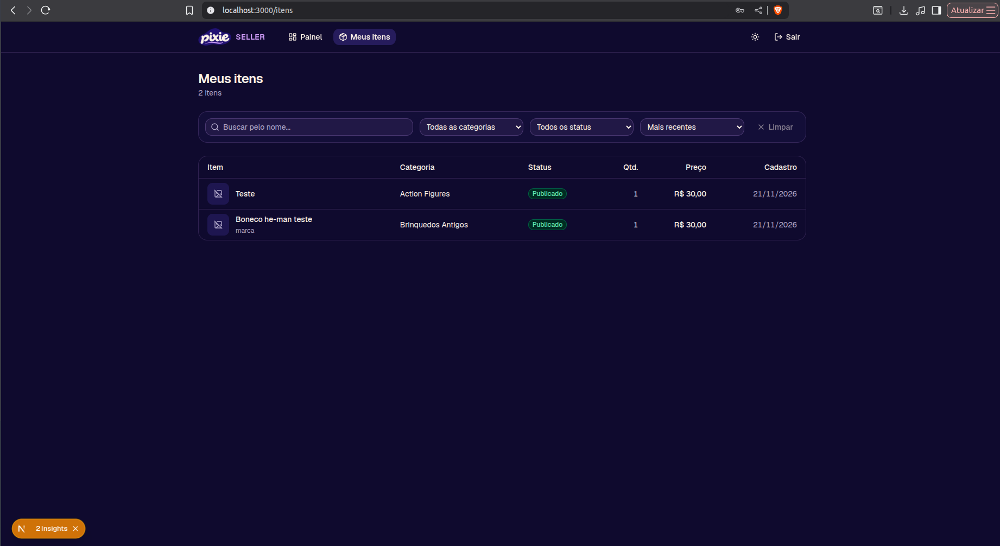
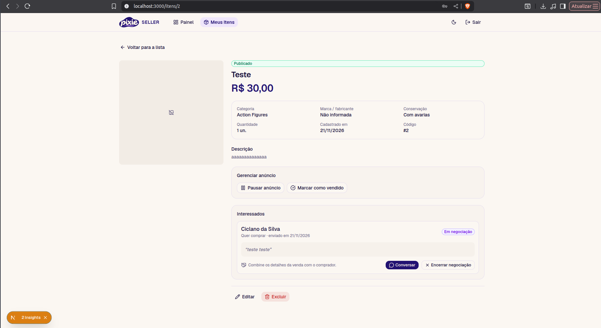
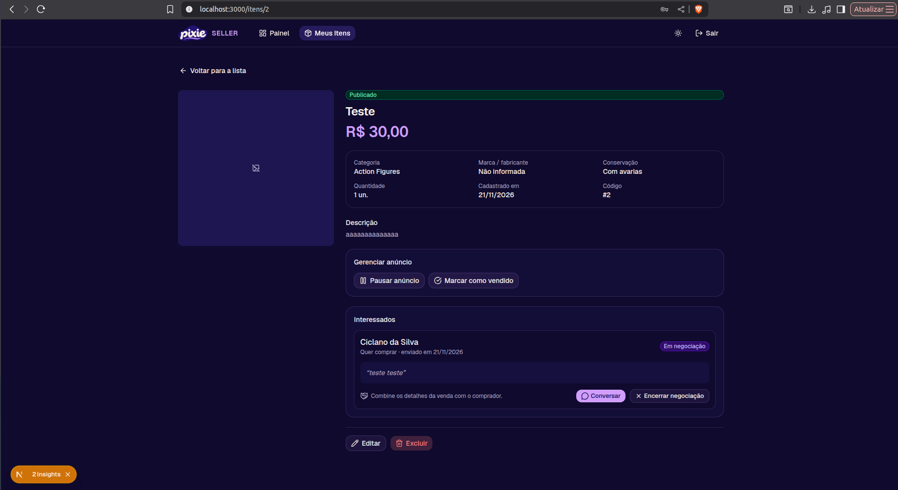
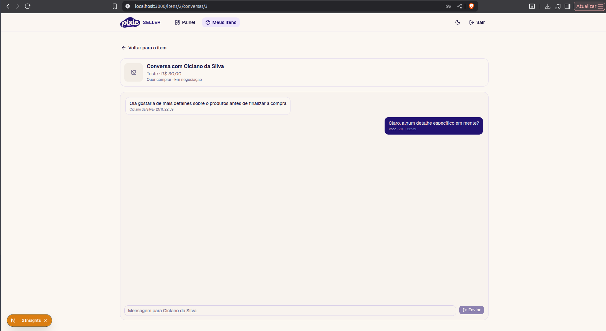
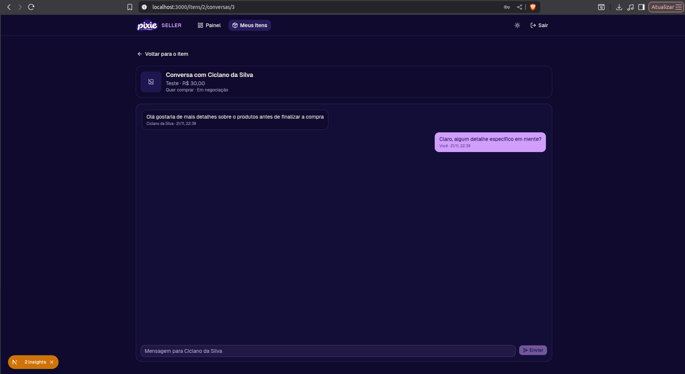

# Pixie Seller

Painel web do vendedor da plataforma **Pixie**, um marketplace e comunidade de itens colecionáveis.
Projeto 1 da disciplina Desenvolvimento de Aplicações Web 3 (IFPB, Campus Esperança, 2026.2).

O Pixie tem duas aplicações:

- **Pixie Mobile**: app dos compradores, para explorar os anúncios, demonstrar interesse e conversar com o vendedor.
- **Pixie Seller** (este repositório): site em que o vendedor cadastra os itens da coleção e gerencia os anúncios.

📄 A documentação do projeto (tema, modelo de dados, regras de negócio e justificativa da persistência) está em [docs/documentacao.md](docs/documentacao.md).

## Funcionalidades

- **Conta do vendedor**: cadastro (nome, CPF, e-mail e senha) e login pelo Supabase Auth. Sem login, todas as páginas redirecionam para a tela de entrada, e cada vendedor só vê e altera os próprios itens.
- **Painel**: totais por status do anúncio, valor anunciado, valor vendido, itens por categoria e últimos cadastros.
- **CRUD completo do Item de Coleção**: cadastrar, listar, ver detalhes, editar e excluir (com confirmação).
- **Listagem**: busca pelo nome, filtro por categoria e por status, e ordenação por data, nome ou preço.
- **Validação do formulário**: campos obrigatórios, tamanho dos textos, preço no formato brasileiro, quantidade inteira e URL da imagem.
- **Ciclo de vida do anúncio**: rascunho → publicado ⇄ pausado → vendido. Só aparecem as transições permitidas, e não é possível publicar um item sem preço ou sem estoque. Rascunhos e anúncios pausados não aparecem para os compradores.
- **Interesses recebidos**: na página do item, o vendedor vê as propostas de compra ou troca feitas pelos compradores no Pixie Mobile e pode aceitar (inicia a negociação), recusar ou encerrar. Marcar o item como vendido encerra os interesses abertos.
- **Chat com o comprador**: depois que a proposta é aceita, vendedor e comprador conversam em uma página própria, com mensagens em tempo real (Supabase Realtime). Quando o interesse é encerrado, a conversa fica só para leitura.
- **Tema claro / escuro**: botão no menu, com a escolha salva no navegador.
- **Feedback**: mensagens de sucesso e erro, indicadores de carregamento, telas de lista vazia e de erro com a opção "Tentar novamente".
- **Layout responsivo**: tabela no computador e cards no celular.

## Tecnologias

| Camada | Tecnologia |
|---|---|
| Interface | React 19 + Next.js 16 (App Router), TypeScript |
| Estilo | Tailwind CSS 4 + componentes shadcn/ui (Base UI), ícones lucide-react |
| Persistência | Supabase (PostgreSQL na nuvem) via `@supabase/supabase-js` |

## Como executar

Pré-requisitos: Node.js 20 ou superior e acesso ao projeto Supabase.

```bash
git clone <url-do-repositorio>
cd pixie-dawIII
npm install
```

1. Crie o arquivo `.env.local` na raiz do projeto. Ele não vai para o Git. Os valores ficam no Supabase, em **Project Settings → API**:
   ```
   NEXT_PUBLIC_SUPABASE_URL=https://ucakjcquyawyzxrumiot.supabase.co
   NEXT_PUBLIC_SUPABASE_ANON_KEY=sb_publishable_JoQEAGIEFgcRW5eBPPJCng_4B0ayQhx

   ```
   Use somente a chave **pública**. Nunca coloque a `service_role` neste arquivo.
2. Inicie o servidor:
   ```bash
   npm run dev          # http://localhost:3000
   ```

### Executar no Android (RT05)

O computador e o celular precisam estar na mesma rede Wi-Fi.

```bash
npm run dev:rede     # ou: npm run build && npm run start:rede
```

- **Celular físico**: abra o Chrome em `http://<IP-do-computador>:3000`. O IP aparece no terminal, em "Network".
- **Emulador Android Studio**: abra o Chrome em `http://10.0.2.2:3000`.

## Estrutura

```
app/                      páginas (rotas do Next.js)
  login/, cadastro/       entrada e criação de conta do vendedor
  page.tsx                painel inicial
  itens/page.tsx          listagem com busca, filtros e ordenação
  itens/novo/page.tsx     cadastro de item
  itens/[id]/page.tsx     detalhes, status, exclusão e interesses recebidos
  itens/[id]/editar/      edição
  itens/[id]/conversas/[interesseId]/  chat com o comprador
components/               componentes de interface (FormularioItem, ListaItens, InteressesItem, ChatInteresse, ProtecaoRota...)
  ui/                     componentes base do shadcn/ui
hooks/useCarregarItem.ts  carrega um item pelo id, com estados de carregamento e erro
lib/
  supabase.ts             cliente do Supabase
  autenticacao.ts         cadastro, login e logout do vendedor
  servicoItens.ts         itens e interesses recebidos
  servicoChat.ts          mensagens do chat, com tempo real
  validacao.ts            validação dos formulários e regras de negócio do anúncio
  tipos.ts                tipos TypeScript (ItemColecao, StatusAnuncio, InteresseRecebido...)
  formatacao.ts           formatação de moeda e data (pt-BR)
  tema.ts                 tema claro/escuro
docs/                     documentação do projeto
```

O fluxo é sempre o mesmo: **página → serviço (`autenticacao`, `servicoItens` ou `servicoChat`) → Supabase**. As páginas não montam consultas SQL, e as regras de negócio ficam em `lib/validacao.ts`.

## Capturas de tela

| Tela | Tema claro | Tema escuro |
| --- | --- | --- |
| Login |  |  |
| Painel |  |  |
| Meus itens |  |  |
| Detalhes e interessados |  |  |
| Conversa |  |  |
