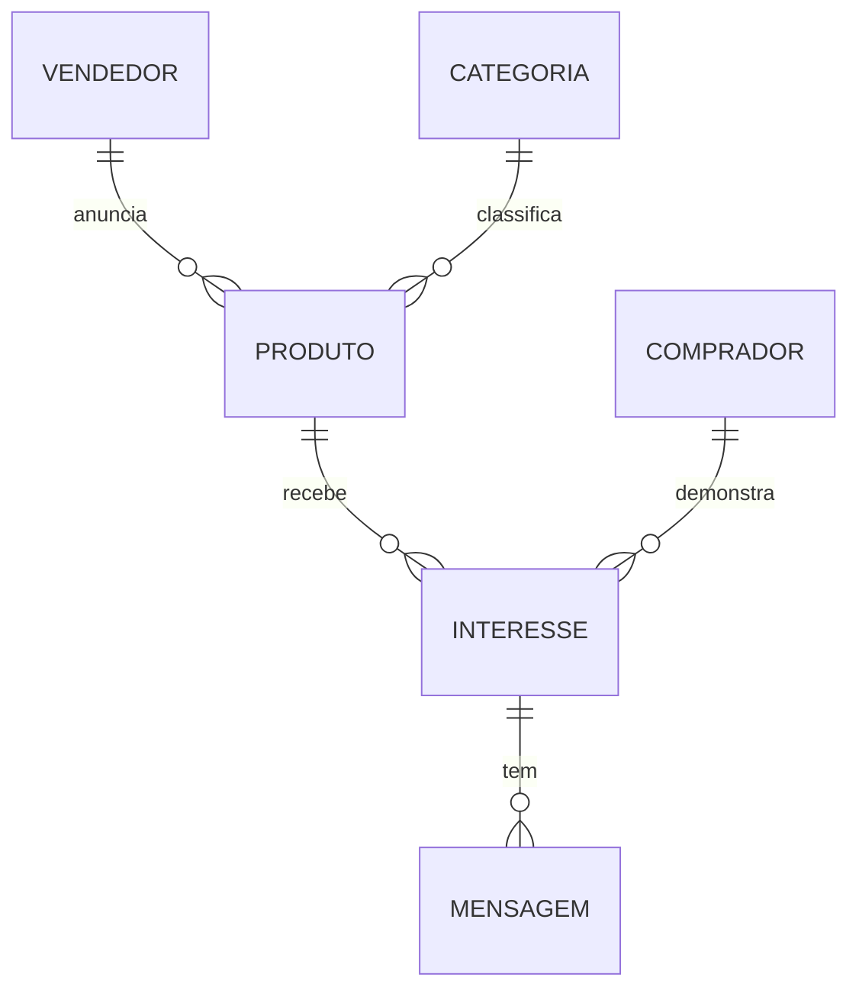

# Pixie Seller — Documentação do Projeto 1

**Disciplina:** Desenvolvimento de Aplicações Web 3 — IFPB Campus Esperança, 2026.2
**Tecnologia:** Next.js 16 (React 19, TypeScript) e Supabase

## 1. Tema

O **Pixie** é um marketplace de **artigos colecionáveis** (cartas, action figures, moedas, quadrinhos, discos de vinil). O modelo de negócio parte de um problema real: faltam plataformas especializadas para quem coleciona.

Este projeto é o **Pixie Seller**, o painel web do **vendedor**. Nele, o vendedor cria uma conta, cadastra os itens da coleção, controla o ciclo de vida de cada anúncio (rascunho, publicado, pausado, vendido), responde às propostas dos compradores e conversa com eles por um **chat em tempo real**.

Os compradores usam o **Pixie Mobile**, o app da disciplina Programação para Dispositivos Móveis. Os dois sistemas compartilham o mesmo banco no Supabase. Um anúncio publicado no Pixie Seller aparece no app, e o interesse enviado pelo app chega ao vendedor no painel.

A **entidade principal** é o **Item de Coleção** (tabela `produtos`), com CRUD completo: cadastrar, listar, ver detalhes, editar e excluir.

## 2. Modelo de dados

Cada item pertence a **um vendedor**. Um item pode receber interesses de vários compradores, e cada interesse aceito abre **uma conversa**.

| Classe / tabela | Campos | Observações |
| --- | --- | --- |
| **Item de Coleção** (principal) — `produtos` | id, titulo, descricao, categoria_id, marca, condicao, preco, quantidade, imagens, status, vendedor_id, criado_em | `condicao` (estado de conservação): lacrado, novo, usado ou com avarias. `status`: rascunho, disponível (exibido como "Publicado"), pausado ou vendido. `imagens` guarda a URL da foto. |
| **Vendedor** — `vendedor` | id, nome, cpf, email, criado_em | Criado automaticamente quando a pessoa se cadastra pelo painel. O `id` é o mesmo do usuário do Supabase Auth, e o CPF é único. |
| **Categoria** — `categorias` | id, nome | Compartilhadas com o Pixie Mobile. |
| **Interesse** — `interesses` | id, produto_id, comprador_id, tipo, valor_oferecido, item_troca, mensagem, status, criado_em | Criado pelo comprador no app. `tipo`: compra ou troca. `status`: aguardando resposta, em negociação ou encerrado. O vendedor não acessa a tabela diretamente: ele lista e responde os interesses por funções do banco que conferem se o item é dele. |
| **Comprador** — `comprador` | id, nome, cpf, email, criado_em | Criado pelo app. O painel mostra só o nome do comprador, sem expor CPF e e-mail. |
| **Mensagem** — `mensagens` | id, interesse_id, autor_id, conteudo, criado_em | Conversa entre o vendedor e o comprador de um interesse. O `autor_id` é preenchido pelo banco com o usuário logado. `conteudo`: 1 a 1000 caracteres. |

**Regras de negócio**

- Nome do item (3 a 100 caracteres), descrição (10 a 1000), categoria, estado de conservação, preço, quantidade e status são obrigatórios. A marca é opcional (até 60 caracteres) e a imagem, se informada, precisa ser um endereço `http://` ou `https://`.
- O preço usa o formato brasileiro (ex.: 149,90), não pode ser negativo, tem no máximo 2 casas decimais e vai até R$ 1.000.000,00. A quantidade é um número inteiro de 0 a 9999.
- Ciclo de vida do anúncio: **rascunho → publicado ⇄ pausado → vendido**. A tela só mostra as mudanças permitidas a partir do status atual, e um item vendido não muda mais.
- Só é possível publicar um item com preço maior que zero e pelo menos 1 unidade em estoque.
- Rascunhos e anúncios pausados não aparecem para os compradores no app.
- Cada vendedor só vê, edita e exclui os próprios itens. A exclusão pede confirmação.
- Interesses: o vendedor pode **aceitar** (aguardando → em negociação), **recusar** (aguardando → encerrado) ou **encerrar** a negociação (em negociação → encerrado). Quando o item é marcado como vendido, todos os interesses abertos nele são encerrados automaticamente.
- O chat só existe depois que o vendedor aceita a proposta. Mensagens só podem ser enviadas enquanto o interesse está em negociação; depois de encerrado, a conversa fica só para leitura.
- Cadastro: nome (2 a 80 caracteres), CPF válido (com dígitos verificadores), e-mail, senha com no mínimo 6 caracteres e confirmação de senha.

**Segurança:** as regras de acesso do banco (Row Level Security) garantem que cada vendedor só grava nos próprios itens, só responde interesses dos próprios itens e só lê e envia mensagens nas próprias conversas, mesmo que alguém tente acessar a API diretamente. Sem login, todas as páginas do painel redirecionam para a tela de entrada.

## 3. Justificativa da persistência: Supabase (PostgreSQL)

1. **Dados compartilhados entre os dois sistemas:** o vendedor (painel web) e o comprador (app mobile) leem e gravam no mesmo banco. O anúncio publicado no painel aparece de verdade no app, e a proposta do comprador chega ao vendedor. Com um armazenamento local no navegador isso não seria possível.
2. **Modelo relacional:** o item aponta para uma categoria e um vendedor; o interesse aponta para um item e um comprador; a mensagem aponta para um interesse. O PostgreSQL garante essas ligações com chaves estrangeiras e impede dados inválidos com restrições `CHECK` e `UNIQUE` (por exemplo, preço ou quantidade negativos e CPF repetido).
3. **Consultas no banco:** busca por nome (`ilike`), filtros por categoria e status e ordenação por data, nome ou preço rodam no servidor. O painel recebe só o resultado.
4. **Login e segurança:** o Supabase Auth cuida do cadastro e do login, e o RLS limita cada vendedor aos próprios dados. Uma mesma conta pode ser vendedora no painel e compradora no app.
5. **Tempo real:** o Supabase Realtime avisa o painel quando chega uma mensagem nova no chat, sem precisar recarregar a página.
6. **Persistência local:** só a preferência de tema claro/escuro fica no `localStorage` do navegador, porque é uma escolha do aparelho e precisa funcionar antes do login.
